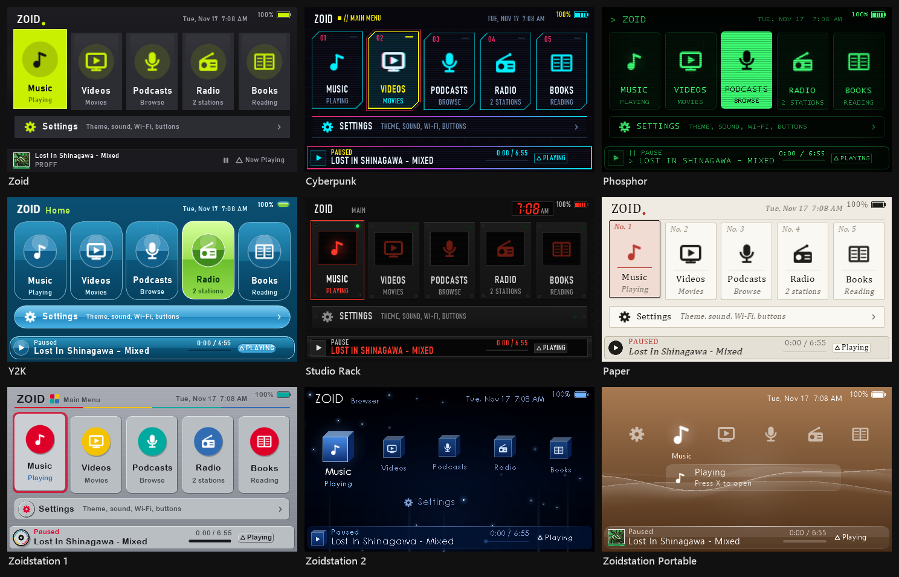

# ZOID for PSP

A homebrew media app for the Sony PSP: music (MP3, FLAC, WAV, M4A/AAC), videos, internet radio, podcasts, and manga and comics, in nine themes. Everything is drawn by the PSP's GPU at 60 fps, and audio and video use the PSP's hardware decoders wherever they can.

## Features

- **Music**: MP3, FLAC, WAV (24-bit and high sample rates included) and M4A/AAC. Gapless playback, crossfade, trim silence, album/disc/track sorting, shuffle all, playlists, cover art, a 10-band equalizer, synced lyrics (from `.lrc` files or LRCLIB), 25 visualizers and resume on start.
- **Videos**: H.264 `.mp4` decoded by the Media Engine, with subtitles, zoom and skips. A Windows converter is included.
- **Internet radio**: search Radio Browser or browse by genre, popularity and local stations, plus iHeartRadio's AM/FM directory. HTTPS streams work through BearSSL.
- **Podcasts**: Apple's directory, subscriptions, new episodes, offline saving and per-episode resume.
- **Books**: `.cbz` files and folders of pages, right-to-left manga reading, smooth zoom, upright reading, bookmarks and progress.
- **Themes**: Zoid, Cyberpunk, Phosphor, Y2K, Studio Rack, Paper, Zoidstation 1, Zoidstation 2 and Zoidstation Portable. Each has its own layout and fonts, not just different colors.
- **Battery**: screen off on HOLD, a 222 MHz mode, or keep your CFW's overclock. Wi-Fi turns itself off when idle.

More screenshots are in [docs/screenshots](docs/screenshots).

## Install

Download the latest zip from the Releases page and copy its `PSP` folder to the root of your Memory Stick, so you have `PSP/GAME/ZOID/EBOOT.PBP` and `PSP/GAME/ZOID/zoidvol.prx`. Custom firmware is required. It's tested on a PSP-3000 with ARK-5, and PSP Go internal storage works too.

Put music in `MUSIC`, videos in `VIDEO` and books in `BOOKS` on the root of the Memory Stick. The `README.txt` in the zip covers controls, file names, video conversion and shrinking books.

## Building

You need Windows and the PSPDEV toolchain.

1. Download the Windows build of the [PSPDEV toolchain](https://github.com/pspdev/pspdev/releases) and unzip it as `pspdev-win` next to the `PSP` folder.
2. In PowerShell, run `PSP/build.ps1`. It builds BearSSL the first time, then `PSP/EBOOT.PBP` and `PSP/zoidvol.prx`.
3. `PSP/make-release.ps1` builds the release zip in `Release/`.

[PSP/README.md](PSP/README.md) is the full technical guide. It covers every screen and file format, the controls, and the automated tests (`run-test.ps1`), which drive a muted PPSSPP emulator placed at `Build/PSP-QA/emulator`.

## Credits

- [BearSSL](https://bearssl.org) by Thomas Pornin (MIT) for HTTPS
- [dr_flac and dr_wav](https://github.com/mackron/dr_libs) by David Reid (public domain or MIT-0)
- Station directory from [Radio Browser](https://www.radio-browser.info), lyrics from [LRCLIB](https://lrclib.net), and podcasts from Apple's iTunes Search API
- Built with [PSPDEV](https://github.com/pspdev)

ZOID isn't affiliated with Sony, iHeartMedia or Apple. The iHeartRadio directory is the one iHeart's own website uses; it isn't an official public API, so it may change.

## License

MIT. See [LICENSE](LICENSE). Bundled third-party code keeps its own license.
